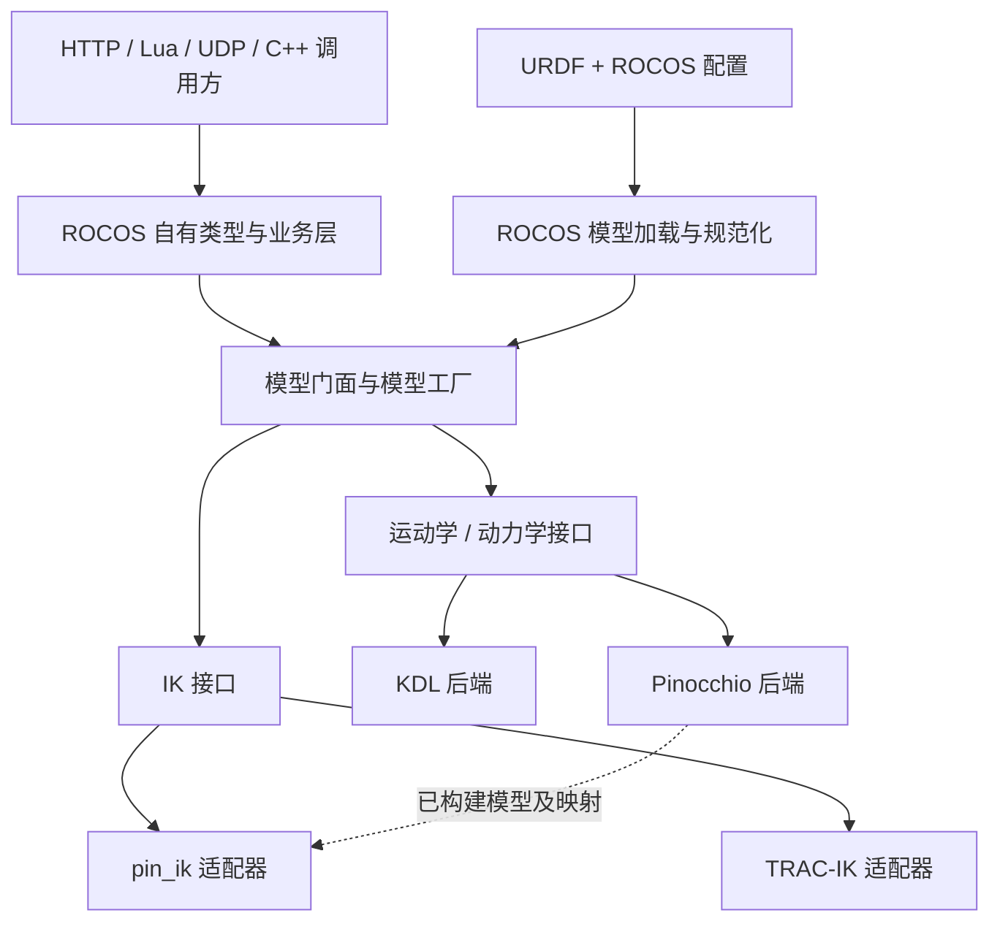

# Pinocchio 后端迁移可行性评估与修改方案

评估日期：2026-11-02。本文保留迁移前的设计与源码评估；其中的“当前实现”均指下述评估基线。

**实施更新（2026-11-03）：** 已按后续要求完成最小迁移：Talon 改用 revolute 与标准 URDF 限位，先验证自有类型 + KDL，再切换 Pinocchio + pin_ik。实际保留单一 Model/Pimpl，没有实现本文提议的多后端工厂或运行时回退；实施范围、构建方式和验证结果以[迁移实现与验证](pinocchio_backend_migration.md)为准。性能和硬件验收仍未完成。

评估基线：ROCOS-App `93a39b586373761f2dd9ad4a277051664f7b952c`；pin_ik `553fd1f1fc3bad594af3f4b3214535707f83c58b`（CMake 项目版本 2.2.0）。Pinocchio 以 pin_ik README 指定的 **v3.9.0** 为首轮验证候选，并核查该 tag 的源码；不把 Pinocchio 默认分支的能力或兼容性直接套用到这个版本。

## 1. 结论与边界

**方案可行，建议分阶段实施。优先完成 ROCOS 自有类型和后端边界，再引入 Pinocchio，最后验证并切换 pin_ik。** 三项工作的必要性不同：

| 提议 | 可行性 | 必要性与决策 |
| --- | --- | --- |
| Pinocchio 替换 KDL 的运动学、动力学计算 | 高，但不是直接替换头文件 | 对统一模型、扩展动力学算法有价值；仅为现有串联臂 FK/重力补偿，尚无实测证据证明必须更换。作为可选后端引入，通过验收后再设为默认 |
| pin_ik 仅负责 IK | 有条件可行 | 适合延续现有 TRAC-IK 的求解方式，避免重写整套 IK 搜索；不是使用 Pinocchio 的唯一选择。需先解决当前机器人关节约束适配及调用时序 |
| ROCOS 定义自有机器人数据结构 | 高 | 优先级最高；现有类型别名并未隔离 KDL，已经影响业务层和公开 C++ 接口。即使最终继续使用 KDL，这项改造仍有独立价值 |

根据本次确认，目标职责是：

- **ROCOS 模型层**：读取原始 URDF 和项目扩展，确定有效关节语义、限位、关节顺序、base/tip、惯量及模型版本。
- **Pinocchio 后端**：从上述统一模型输入构建完整的 `pinocchio::Model`，负责 FK、Jacobian、逆动力学和正动力学。
- **pin_ik 适配器**：接收已经构建好的 Pinocchio 模型、有效位置限位和 tip frame，调用“已有模型”构造函数，仅执行 IK。其内部复制模型属于求解器实现细节。
- **KDL 后端**：迁移期保留作兼容实现、数值对照及回退选择。
- **业务和外部 C++ 接口**：只使用 ROCOS 定义的类型；HTTP/JSON、Lua、UDP 各自在边界转换。

这里的 URDF 是共同的机器人描述输入，并不存在需要单独对外定义的“Pinocchio URDF 格式”。不让 Pinocchio 后端和 pin_ik 各自解析原始 URDF、各自决定限位和关节链。

需要修正原前提：**Pinocchio 提供构建数值 IK 所需的 FK、Jacobian、李群运算，并有官方 C++ IK 示例；它不等同于项目当前使用的、带限位与搜索策略的 TRAC-IK 求解器。** 因此引入 pin_ik 的理由是复用 IK 策略和工程封装，而不是 Pinocchio 完全不能计算 IK。[官方 IK 示例](https://github.com/stack-of-tasks/pinocchio/blob/devel/examples/inverse-kinematics.cpp)

## 2. 当前实现与实际改造范围

### 2.1 已有抽象可复用，但类型边界尚未建立

当前所谓 `rocos::KDL` 依赖，主要表现为 KDL 原生类型及其在 `rocos` 命名空间中的别名，并非独立的后端抽象。

| 位置 | 已核查的实现 | 对迁移的影响 |
| --- | --- | --- |
| [types.hpp](../src/types.hpp) | `Vector/Jacobian/JntArray/Frame/Wrench/Twist/Chain/Tree` 以及求解器类型均为 KDL 别名 | 改名不会形成隔离；不能把这些别名整体换成 Pinocchio 类型就结束 |
| [model_interface.hpp](../src/model_interface.hpp) | 已有 FK、IK、FD、ID、Jacobian、关节名称与限位接口 | 可作为演进起点；参数仍绑定 KDL，外力数组也隐含 KDL segment 索引 |
| [model.cpp](../src/model.cpp)、[model.hpp](../src/model.hpp) | KDL FK/Jacobian/FD/ID，IK 实际使用 vendored TRAC-IK；公开 `GetChain()` | 拆分后端、隐藏求解器和 chain，保留上层功能入口 |
| 同上 | URDF 标准限位后，再以 `<hardware><limit>` 按字段覆盖；名称按 base→tip 活动关节排序 | 新模型必须保持有效限位和顺序；不能只依赖第三方 URDF parser |
| [robot.cpp](../src/robot.cpp) | 直接构造 `Model`，把模型交给控制器和规划器；根据硬件周期设置 `dt_` | 引入工厂和执行上下文，识别实时与非实时调用方 |
| [joint_binding.hpp](../src/joint_binding.hpp) | 根据模型关节名绑定硬件 drive_id | 固定 ROCOS 关节顺序，禁止用 Pinocchio joint ID 直接索引硬件 |
| [cartesian_impedance_controller.cpp](../src/cartesian_impedance_controller.cpp) | `KDL::diff`、6×n Jacobian、`JᵀF`、`InverseDynamics(q,0,0,{})` | 位姿误差、参考点、坐标轴与重力符号必须保持 |
| [zero_force_drag_controller.cpp](../src/zero_force_drag_controller.cpp) | 机器人重力补偿之外，另算负载质量和质心造成的力矩 | 新后端不得又把相同负载计入模型，造成重复补偿 |
| `move_line*`、`move_circle*`、`move_jog*`、`move_null_jog`、`move_svd_jog`、`virtual_wall*` | 使用 Frame/Twist/Jacobian 或直接调用 KDL 几何函数 | 需要几何运算兼容层，不只是修改 `model.cpp` |
| `frame_registry`、`tool_package`、`tool_calibration`、`robot_http_server`、`lua_script_engine`、`hardware` | KDL 类型用于坐标系、标定、序列化及力传感器数据 | 属于类型迁移范围；网络和配置格式不应随计算后端变化 |
| [dh_params_loader.hpp](../src/dh_params_loader.hpp) | 独立 DH 加载器公开 KDL Chain/Frame；当前主库源文件列表未包含其实现 | 纳入残留依赖清单；保留该功能时应输出自有模型描述，不把它误认为当前 URDF 主路径 |
| [CMakeLists.txt](../CMakeLists.txt) | `find_package(orocos_kdl REQUIRED)`，构建 vendored TRAC-IK/NLopt/kdl_parser，`robot` PUBLIC 链接 KDL/TRAC-IK | 分离后端 target、收敛依赖传播；仅移除 `3rdparty/kdl` 目录不会消除系统 KDL 依赖 |

当前 `GetJacobian()` 每次构造 KDL solver，空外力向量在 FD/ID 内临时扩展；这些是可独立优化的点，**不能把消除现有分配的收益全部归因于换库**。

已有测试可作起点，但 [model_test.cc](../test/model_test.cc) 主要覆盖 Talon 限位、零位 FK 和一个 IK/FK 往返，不足以证明两种后端等价。

### 2.2 为什么自有类型值得先做

收益是让坐标系、单位、关节顺序、错误处理成为 ROCOS 的稳定约定，使规划器、控制器和协议适配器不需要理解每个后端的内部表示。它还允许独立比较、升级和移除计算后端。

代价也应明确：自有类型需要数学操作和测试；转换需要成本；公开 C++ 签名改变通常涉及源码/二进制兼容性。无需自研通用线性代数库，也不必第一阶段实现浮动基、闭链、多机器人和任意流形模型。

**推荐首期范围：固定基、单串联链、每个可动关节一个标量，覆盖有界转动、真正连续转动、移动关节和固定连杆。** 未来多自由度关节必须显式扩展接口，不假设“关节数、配置维数、速度维数永远相同”。

## 3. Pinocchio 与 pin_ik 的适配判断

### 3.1 Pinocchio：计算能力满足需求，实际收益需要测量

Pinocchio 具备运动学、动力学及导数计算能力。针对当前接口，可映射为下表。具体版本和构建依赖应锁定，不追随默认分支自动升级。[项目说明](https://github.com/stack-of-tasks/pinocchio)

| ROCOS 能力 | Pinocchio 实现方向 | 适配要求 |
| --- | --- | --- |
| FK | `forwardKinematics` + `updateFramePlacements`，读取目标 frame 的位姿 | 使用 flange 的 frame ID，不把最后一个 joint 的位姿当法兰 |
| Jacobian | `computeFrameJacobian` / `getFrameJacobian` | 当前语义优先对应 base 对齐的末端原点 Jacobian；见第 5 节 |
| 逆动力学 | `rnea` | 同一惯量、重力、外力约定与关节顺序 |
| 正动力学 | `aba` | 单独校验质量矩阵有效性及外力映射，不能仅验证 FK |
| 重力补偿 | `computeGeneralizedGravity` 或 `rnea(q,0,0)` | 和当前 ID 调用对照，再决定是否新增专用接口 |

未来若需要质量矩阵、偏置力、动力学导数或更复杂优化，Pinocchio 的收益会增加；当前并没有针对本项目目标机器的基准结果，因此不承诺更低延迟或更高 IK 成功率。

### 3.2 pin_ik：采用已有模型接口，只承担 IK

已核查的接口为：

```cpp
// 仅出现在 Pinocchio/pin_ik 后端实现文件中。
PIN_IK::PIN_IK solver(pin_model, lower, upper, tip_frame_id,
                      timeout_seconds, epsilon, PIN_IK::Speed);
int count = solver.CartToJnt(seed_angles, target_base_flange, solution_angles);
```

`seed/solution/limits` 按 pin_ik 约定为 `model.nv` 个关节标量；原生 Pinocchio 配置向量可能是 `nq` 维。成功应要求 `count > 0`，并重新检查有限值、尺寸、限位和独立 FK 残差；返回负值时不能把回填的 seed 当成功解。[接口源码](https://github.com/thinkexist1989/pin_ik/blob/553fd1f1fc3bad594af3f4b3214535707f83c58b/include/pin_ik/pin_ik.hpp)、[求解实现](https://github.com/thinkexist1989/pin_ik/blob/553fd1f1fc3bad594af3f4b3214535707f83c58b/src/pin_ik.cpp)

当前支持单标量 revolute/continuous/prismatic，不能据此宣称支持 Pinocchio 所有模型。首期显式拒绝 mimic、floating、planar、多自由度和非祖先 base→tip 请求，不允许静默丢弃这些约束。[类型校验](https://github.com/thinkexist1989/pin_ik/blob/553fd1f1fc3bad594af3f4b3214535707f83c58b/include/pin_ik/pinocchio_types.hpp)

还有三项不能照搬 README 的地方：

1. **实时性**：每次 `CartToJnt()` 创建两个 `std::thread` 后 `join`，使用锁、动态向量及随机重启。超时是搜索预算，不是调用墙钟时间的硬上界；`Speed` 也不因此成为硬实时算法。`Distance` 和 `Manip*` 会继续搜索到预算耗尽，不适合直接替换短周期调用。
2. **搜索保证**：优化器实际使用 `nlopt::LD_SLSQP`；并行迭代与随机重启不保证找到所有可行解，更不保证全局最优。README 的“全局优化器”应按实现收窄理解。[NLopt 调用源码](https://github.com/thinkexist1989/pin_ik/blob/553fd1f1fc3bad594af3f4b3214535707f83c58b/src/nlopt_ik.cpp)
3. **Manip 模式**：实现中的 Manip1 为奇异值乘积、Manip2 为最小/最大奇异值、Manip3 为最小奇异值，乘限位惩罚后按高分优先；与 README 的部分文字解释不同。首期不把这些模式包装为业务承诺，并注意混合平移/转动量纲会影响评分。[评分源码](https://github.com/thinkexist1989/pin_ik/blob/553fd1f1fc3bad594af3f4b3214535707f83c58b/src/pin_ik.cpp)

上游已有五种模式、连续关节、非根 base 和随机目标测试，但这不是 ROCOS 模型、周期和控制器的验证记录；本次没有执行这些测试。[上游测试](https://github.com/thinkexist1989/pin_ik/blob/553fd1f1fc3bad594af3f4b3214535707f83c58b/tests/standalone_tests.cpp)

### 3.3 当前机器人存在必须先解决的限位冲突

[Talon URDF](../config/robots/talon/robot.urdf) 的 7 个活动关节均声明为 `continuous`，同时在 `<hardware><limit>` 中具有有限上下限。例如 joint_1 为 `[-2.84, 2.84]` rad。当前 `Model::ParseUrdf()` 读取这些扩展，TRAC-IK 根据传入的有限限位将其作为有界转动关节处理。

pin_ik 的 `validateLimits()` 则按 **Pinocchio 关节模型类型** 判别 continuous，并要求其上下限严格为 `(-inf,+inf)`。因此以下两种直接接入都不正确：

- 原样导入 continuous 模型并传硬件有限限位：构造/校验将拒绝。
- 原样导入并使用无穷限位：丢失当前有效行程约束；事后拒绝越界解也不等于在约束内求解。

**推荐处理**：ROCOS 模型加载层保留原始 URDF，另生成用于计算的规范化描述。对于同时有有限上下限、且确认属于受限转动轴的 continuous 声明，在计算模型中使用有界 revolute 关节，保留原 axis、origin、惯量、名称及有效限位；两个后端都消费同一语义。原始文件和对外 URDF 返回不在这次后端接入中悄悄改写。

真正无限旋转关节保留 continuous 表示，对外保持未折返的角度和圈数；进入 Pinocchio 时才转换为 `(cos θ,sin θ)`，输出等价角选取靠近 seed 的分支。若今后要支持带有限工作窗口的多圈连续轴，应另行扩展 pin_ik 约束语义并测试，而不是把所有 continuous 一律改成 revolute。单边限位等未覆盖情况应报明确的模型不支持错误。

模型适配后，Talon 的有效关节顺序和所有有限限位必须与现有 [model_test.cc](../test/model_test.cc) 完全一致。

### 3.4 动力学模型由 ROCOS/Pinocchio 独立负责

源码检查发现 pin_ik 自带 `loadURDFModel()` 提取链时重建 joint/frame，未复制原模型刚体惯量。**本方案不使用这条加载路径构建动力学模型**，因此这不是“pin_ik 作为纯 IK 求解器”的否决项，而是需明确保持的边界。[链提取源码](https://github.com/thinkexist1989/pin_ik/blob/553fd1f1fc3bad594af3f4b3214535707f83c58b/src/urdf.cpp)

ROCOS 的规范化模型必须保留链内所有固定连杆、惯量原点、质心和惯性张量，使用 Pinocchio 正规解析/构建流程生成完整模型，然后交给 IK 适配器。禁止反向从 `pin_ik::getModel()` 获取动力学真值。

对于带分支或非根 base 的模型，首期明确保持现有 KDL base→tip 串联链范围；排除链外分支是显式建模决策。不能直接使用整个 URDF 树参与动力学，也不能假设 `buildReducedModel` 锁关节就等同于删除链外支路——锁住的支路仍可能贡献惯量。需要全树负载时再扩展模型范围。

## 4. 推荐的数据结构与模块边界

### 4.1 自有类型，避免再次绑定后端

建议新增 `include/rocos/math/`、`include/rocos/model/`，`src/types.hpp` 在迁移期作为转发入口。公开接口可以使用标准库基础类型和容器；“只暴露自身数据结构”指机器人领域类型及其语义由 ROCOS 所有，禁止泄漏 KDL/Pinocchio/Eigen 的领域表示。

| 类型 | 内容与约定 |
| --- | --- |
| `Vector3`、`Quaternion` | double 分量；四元数显式字段 x/y/z/w，身份旋转 w=1；入口校验有限值和范数 |
| `Pose` | 平移和单位四元数；`T_A_B` 把 B 中的坐标变换到 A；几何运算由 ROCOS 提供 |
| `Twist` | `linear`、`angular`；速度作用点和表达坐标系由请求描述，禁止默认为完整空间伴随变换 |
| `Wrench` | `force`、`torque`；力矩必须绑定参考点 |
| `JointPosition/JointVelocity/JointAcceleration/JointEffort` | ROCOS 自有强类型向量；按稳定关节顺序存放，各量有不同单位；启动时定长 |
| `Jacobian` | 自有 6×n 容器，明确行序为 `[linear; angular]`，列序为 ROCOS 活动关节顺序 |
| `JointInfo/JointLimits` | 名称、有效类型、位置/速度/加速度/jerk/力矩约束、配置维数与速度维数信息及来源 |
| `LinkInfo/FrameId/SpatialInertia` | 稳定 link/frame 身份；质量、质心、关于质心的惯性张量及表达坐标系 |
| `RobotModelDescription` | 不可变拓扑、base/tip、关节/连杆描述、重力、有效约束、原始与规范化模型标识 |
| `ExternalWrench` | 受力 link、表达 frame、力矩参考点、`Wrench`，避免用 KDL segment 数组下标作为公共语义 |
| `IkRequest/IkResult` | 目标、seed、求解策略、分别以 m/rad 表达的残差要求、预算、结果有效性与失败原因 |

不建议 `using Pose = pinocchio::SE3`，也不建议继承 KDL 类型。内部可使用 Eigen 实现数学计算，通过私有转换头或 Pimpl 隐藏；无需重写矩阵分解。C++17 的视图可用自有 `pointer + size` 类型，不直接使用 C++20 `std::span`。实时路径禁止隐式 resize，返回值或输出参数必须使用调用前分配好的容量。

纯标准字段也不会自动保证跨编译器 ABI 稳定；如后续有跨工具链 SDK 需求，另提供 C ABI/opaque handle，不把这项工作强塞进本次后端迁移。

### 4.2 从现有 ModelInterface 演进



保留上层 `ModelInterface` 门面以降低一次性改动，内部拆出 `KinematicsBackend`、`DynamicsBackend` 和 `IkSolver`。默认受支持的组合先限于 KDL+TRAC-IK、Pinocchio+pin_ik；测试可同时构建两种实现。不要允许任意组合静默混用不同模型。

接口方向如下，属于设计草图，并非现有可编译声明：

```cpp
class ModelInterface {
 public:
    virtual ~ModelInterface() = default;
    virtual const RobotModelDescription& Description() const = 0;
    virtual std::unique_ptr<ModelContext> CreateContext() const = 0;
    virtual Result ForwardKinematics(ModelContext&, JointPositionView,
                                     FrameId, Pose&) const = 0;
    virtual Result GetJacobian(ModelContext&, JointPositionView,
                              const JacobianRequest&, Jacobian&) const = 0;
    virtual Result InverseDynamics(ModelContext&, const DynamicsInput&,
                                   JointEffort&) const = 0;
    virtual Result ForwardDynamics(ModelContext&, const ForwardDynamicsInput&,
                                   JointAcceleration&) const = 0;
};

class IkSolver {
 public:
    virtual ~IkSolver() = default;
    virtual Result Solve(const IkRequest&, IkResult&) = 0;
};
```

`ModelContext` 是 ROCOS 拥有的 opaque 工作区，内部存放 Pinocchio `Data` 或 KDL solver/buffer；初始化时创建。`IkSolver` 实例绑定一个工作线程，pin_ik 的 Model/SE3/Eigen 类型只出现在实现文件。工厂验证模型版本、joint mapping 和 tip frame 一致后才能组合。

逐步弃用 `Model::GetChain()`，替换成 `Description()` 的只读信息；不要再提供 `GetPinocchioModel()` 给业务层。确需兼容旧 C++ 调用方时，放在显式可选的 legacy 适配目标中，并计划移除。

## 5. 必须固化的计算语义

### 5.1 坐标、Jacobian 和位姿误差

- 使用 SI：m、rad、s、kg、N、N·m；移动关节的位置/速度分别为 m、m/s，不能统称关节角。
- 保持 `T_base_tcp = T_base_flange × T_flange_tool`；工具包时 `T_flange_tool = mount × local_tcp`。
- 首期 `GetJacobian` 默认仍是 **法兰原点速度、基座方向表达**。Pinocchio 采用以 base 为根的模型及 `LOCAL_WORLD_ALIGNED` frame Jacobian；`WORLD` 的参考点不同，不能直接替换；`LOCAL` 则还需旋转表达坐标轴。[v3.9.0 frame Jacobian 定义](https://github.com/stack-of-tasks/pinocchio/blob/v3.9.0/include/pinocchio/algorithm/frames.hpp)
- TCP Jacobian 要处理偏置：`v_tcp = v_flange + ω × r_base`。六维数组布局相同并不代表参考点相同。
- 力矩平移使用 `τ_O = τ_P + r_OP × F`，再旋转到请求的表达系；只有参考点不变时才仅旋转。检验 `τ_joint = JᵀW` 以及功率一致性。
- 控制器当前 `KDL::diff` 的平移差和姿态误差语义应单独实现为 ROCOS 几何函数，首期保持现有行为。不能直接用 `log6(T_current⁻¹ T_target)` 替换所有 `diff`，它的表达系、平移部分及误差耦合不同。
- 四元数 `q` 与 `-q` 表示同一姿态，比较应使用旋转距离；保持插值最短路径、接近 π 时的数值处理和导数连续性测试。

### 5.2 关节映射和配置空间

加载时建立并验证：

```text
ROCOS joint index ↔ joint name ↔ hardware drive_id
                 ↔ Pinocchio joint_id / idx_q / nq / idx_v / nv
                 ↔ pin_ik scalar index
```

模型变化后必须重建映射和工作区，不在控制循环按名字查找。固定关节不占 ROCOS 关节向量，frame 仍需保留。真正连续关节的角度转换只发生在后端边界，圈数不能从 `atan2` 单独恢复；由反馈/seed 的未折返标量维持。

### 5.3 动力学与外力

Pinocchio 的 `rnea/aba` 外力按 joint 索引、在各 joint 局部坐标系表达；KDL 当前接口按 segment 排列。适配器必须将自有 `ExternalWrench` 根据 link→joint/segment 关系变换并累加，特别是固定连杆上的力。空集合仍表示无外力，但零数组在工作区预分配。[v3.9.0 RNEA](https://github.com/stack-of-tasks/pinocchio/blob/v3.9.0/include/pinocchio/algorithm/rnea.hpp)、[v3.9.0 ABA](https://github.com/stack-of-tasks/pinocchio/blob/v3.9.0/include/pinocchio/algorithm/aba.hpp)

重力在计算 base 中表达；base 相对世界有安装旋转时同步变换重力。固定关节合并时保持质量、质心和惯性张量的完整空间变换。不能只检查质量相等就认为惯量正确。

首期继续由当前零力拖拽控制器补偿已辨识的工具负载，Pinocchio 模型只承担与原 KDL 相同范围的机器人本体动力学；若以后把负载并入模型，必须同时移除对应的额外补偿，并保证模型更新原子化。

### 5.4 并发与实时行为

共享不可变模型，各控制线程、规划任务、HTTP 读请求使用独立工作区；单个 pin_ik 实例不能并发 `Solve`，也不能与 `setLimits` 交叉执行。模型/重力/限位变化在停止运动后构建新实例，所有读取者确认版本切换后再回收旧实例。

[Talon 周期配置](../config/robots/talon/ecm.yaml) 为 1000 μs，当前 TRAC-IK 默认预算已是 5 ms，且同样每次创建两个线程。**这是已有风险，迁移不会自动解决，也不能因为已有就认定新后端实时性合格。** [position_controller.cpp](../src/position_controller.cpp) 等仍有笛卡尔参考值调用 IK 的路径，需要逐一审计。

推荐分开处理：

1. MoveJ_IK、离线 MoveL/MoveC 的点位求解在规划线程调用 pin_ik；保留 seed 连续性和整段轨迹检查。
2. 周期控制优先消费预计算关节轨迹；需要在线求解时另提供迭代数受限、预分配的局部 IK/Jacobian 方法，或经过验证的后台前瞻求解。
3. 后台结果必须携带目标序号、模型版本、seed 状态与有效期限；控制端拒绝迟到/过期/跳变结果。插值、速度/加速度限制和结果断供时的受控停止不能省略。
4. 未完成上述改造前，不把阻塞的双线程 pin_ik 宣称为 1 kHz 实时 IK；是否允许某条现有路径切换，由该路径的延迟与故障验收决定。
5. 超时、无解、限位失败、数值异常统一进入现有失败处理，不在运动中临时切换后端继续发命令。

## 6. 对外协议和兼容性

本次已通过 Apifox MCP **刷新并读取在线“ROCOS API”**：OpenAPI 3.1.0，`info.version=3.0.0`，下载时间 `2026-11-02T14:55:46.768Z`。重点读取 `/api/robot/movej_ik`、`/state`、`/tcp`、`/load_params` 及相关 Pose、RobotStateData、TcpPoseData、MotionResponse、JointState、负载响应 schema；本地 `docs/rocos-API.yaml` 未作为契约依据。

与本次迁移直接相关的约束：

- `Pose` 继续使用 `position.{x,y,z}` 和 `orientation.{x,y,z,w}`；不输出 Pinocchio `SE3` 数组或原生 `nq` 配置。
- `flange` 仍为基座到法兰；`active_tool_frame` 仍是法兰到工具的固定偏置；`tcp` 使用同一关节采样和工具快照，FK/反馈失效时为 null。
- `/api/robot/tcp` 保持 `reference_frame="base"`，失败保留规范要求的响应语义。
- 负载质量单位 kg、质心单位 m，质心在法兰系表达；不要因为后端使用 joint 局部系而改变协议。
- pin_ik 的解数量、负返回值和内部失败原因先映射成 ROCOS 结果；不得直接作为 HTTP 业务码发布。新增外部状态或字段须先更新在线契约。

已抽查 `frameToJson()`、状态快照和 TCP 输出，上述位姿字段与 TCP 语义未发现影响本方案的差异；**这不是全部 HTTP 路由的契约合规审计**。在线 `StandardResponse` 的通用业务码分类描述与部分具体路径的负码描述存在粒度差异，迁移不能据此重编号，实际接口以在线具体定义为准。

HTTP/JSON 可保持兼容，但公开 C++ 类型迁移不能承诺 ABI 不变。Lua 的 Pose 操作、UDP 伺服矩阵的布局、YAML 工具坐标系格式也需原样维持并回归；它们不是由 HTTP OpenAPI 自动覆盖的协议。

## 7. 依赖和构建修改

建议增加以下 target 和源文件分区，具体命名可按现有工程风格调整：

```text
include/rocos/math/                 自有几何与向量类型
include/rocos/model/                描述、请求、工作区与接口
src/model/model_loader.*            原始 URDF / 扩展 / 规范化
src/model/model_factory.*           后端组合、能力检查
src/model/backends/kdl/*            KDL + TRAC-IK 私有实现
src/model/backends/pinocchio/*      Pinocchio + pin_ik 私有实现
test/model_backend_equivalence_test.cc
test/model_conventions_test.cc
test/ik_constraints_test.cc
```

- 建立 `rocos_model_core`、`rocos_model_kdl`、`rocos_model_pinocchio`，主库依赖公共核心及选定实现；公开头文件不得 include 后端头。
- 增加最小外部 C++ 消费者编译检查：只安装 ROCOS 公共头和库，消费者不配置 KDL/Pinocchio include 路径也能编译；用头文件扫描辅助检查类型泄漏，再检查运行时动态库依赖。源码隐藏和运行时依赖是两项独立验收。
- 增加拟议的 `ROCOS_WITH_KDL`、`ROCOS_WITH_PINOCCHIO` 构建选项。初期两者共存且默认保持旧行为；仅在依赖闭包清理后验证 Pinocchio-only 构建。
- Pinocchio 和 pin_ik 通过 CMake imported target 链接，后端依赖尽量 `PRIVATE`。检查导出的包和真实动态库依赖，不能只看 target 声明。
- pin_ik 的 CMake 只写 `find_package(pinocchio REQUIRED)`，并未锁定 README 所述版本。项目需要自己固定 Pinocchio tag、pin_ik SHA、NLopt 来源及编译参数，避免无意接入不同主版本。
- pin_ik 最低 CMake 为 3.16，**Pinocchio v3.9.0 源码最低 CMake 为 3.22**，而 ROCOS 当前为 3.15。完整源码构建建议统一工具链到 ≥3.22；使用预编译依赖时仍需验证消费端的实际要求，不能只按 pin_ik README 判断。[Pinocchio v3.9.0 CMake](https://github.com/stack-of-tasks/pinocchio/blob/v3.9.0/CMakeLists.txt)、[pin_ik CMake](https://github.com/thinkexist1989/pin_ik/blob/553fd1f1fc3bad594af3f4b3214535707f83c58b/CMakeLists.txt)
- 保留 URDF 支持，初期不需要 Python、碰撞、自动微分等可选功能；单独构建依赖时关掉不需要的选项，并验证安装后包可用。避免在 ROCOS 顶层全局关闭 `BUILD_TESTING` 来关闭第三方测试。
- 当前 vendored NLopt 被 TRAC-IK 使用，而 pin_ik 通过 `find_package(NLopt)` 查找；统一供应来源和版本，防止同进程加载两个不一致副本。检查 Boost/Eigen/urdfdom 的 ABI、安装 RPATH 和目标设备部署闭包。
- 发布包保留第三方许可证和版权信息。Pinocchio 项目标注 BSD-2-Clause，pin_ik 标注 BSD-3-Clause；迁移前仍需核对锁定版本和所有传递依赖的实际许可证，不在此推导更广泛的法律结论。

拟议的后端选择配置应加入 `app_config` 的解析、校验和导出，并在 `config/README.md` 记录。后端仅在启动或停止状态下切换，不设计运动中热切换。

## 8. 分阶段实施与退出条件

| 阶段 | 主要修改 | 通过条件 |
| --- | --- | --- |
| P0：建立基线 | 冻结机器人输入、当前依赖、有效限位、关节顺序和离线结果；明确坐标/外力语义 | 可复现 KDL 基线；所有已知模型差异有记录 |
| P1：类型与接口解耦 | 自有类型、数学函数、KDL 适配器；逐步迁移控制器/规划/工具/协议；移除业务层 `GetChain()` | 默认仍是 KDL，现有行为测试通过；公共头文件不泄漏后端类型 |
| P2：统一模型与 Pinocchio | 模型描述和规范化、Talon 有限行程适配、惯量/外力映射、独立工作区、FK/J/ID/FD 后端 | 数值对照、独立物理检验和 Pinocchio-only 依赖检查通过 |
| P3：接入纯 IK 的 pin_ik | 使用已有模型构造函数，统一结果验证、seed/限位、非实时规划路径和超时策略 | Talon 与合成模型 IK 测试通过；不依赖 pin_ik URDF loader |
| P4：控制循环与整机验证 | 清理周期线程内阻塞求解，测试并发、尾延迟、轨迹连续性、故障和回退 | 目标周期预算、数值和运动行为均达到预先设定标准 |
| P5：默认切换与清理 | 按机器人/部署配置切到新后端，保留一段兼容期；最后处理 KDL 去留 | 新部署验证完成；旧配置可以在停止后回滚并重新初始化 |

P1 可逐模块迁移，通过临时转换维持可编译状态，但最终不能长期在每个控制周期来回转换 KDL↔自有类型↔Pinocchio。后端转换尽量一次进入、一次退出，基于测量消除热点复制。

粗略工程量估计（工程判断，非执行承诺）：P0 约 0.5–1 人周，P1 约 2–3 人周，P2 约 1.5–2.5 人周，P3 约 1–2 人周，P4/P5 约 2–4 人周，总计约 **7–12.5 人周**。硬件排期、发布验证和在线 IK 重新设计可能使周期增加。先完成 P0/P1 并验证 Talon 模型适配后，再细化后续估算。

若新后端无显著性能优势但可维护性达标，仍可保留为可选实现；若 pin_ik 不能满足约束或时序，可继续保留 TRAC-IK 后端组合，或在同一 `IkSolver` 接口实现受限的 Pinocchio 局部 IK，不应推倒自有类型和模型层。

## 9. 验收与测试计划

以下为后续迁移的验收设计，**不是本次已经获得的测试结果**。初始容差是建议值，应在目标平台、模型精度和控制需求明确后冻结，不能通过放宽阈值掩盖参考系或惯量错误。

### 9.1 数值正确性

| 项目 | 方法与建议初始标准 |
| --- | --- |
| 类型/几何 | Pose 组合与逆、四元数符号等价、接近 π、TCP 平移、Twist/Wrench 变换和功率守恒；独立解析算例 |
| FK | 同一有效模型、同一关节顺序，随机及边界点比较；初始位置/旋转距离差 ≤1e-9 m/rad，失败先查模型语义 |
| Jacobian | KDL/Pinocchio 对照，并用 FK 中心差分独立验证每列；平移、旋转分开度量，初始误差约 1e-6，检查步长收敛 |
| 逆动力学/重力 | 随机 q/v/a、静态重力、非竖直重力、固定连杆和非零外力；同单位逐分量采用绝对+相对容差，初始各 1e-8 |
| 正动力学 | 对照旧后端，并检验 `ID(q,v,FD(q,v,τ,f),f)≈τ`；加入单摆/两连杆解析案例，避免只检验同一个实现的自洽 |
| 有效模型 | Talon 7 轴限位逐项精确比对；固定连杆惯量、惯性坐标旋转、非根 base、分支裁剪、零/异常惯量的能力错误 |
| 配置空间 | 有界转动、continuous 跨 ±π 与多圈、移动关节；名字重排、idx_q/idx_v 区分和硬件 drive_id 映射 |

IK 不要求不同求解器返回同一个冗余解。要求解在有效限位内，代回独立 FK 后位置误差 ≤1e-5 m、旋转误差 ≤1e-5 rad（初始建议），并检查近奇异、不可达、限位邻域、非法姿态、NaN、超时和失败不下发命令。

建立至少 10,000 个固定种子的可达目标以及专门的困难/不可达集合，分别使用近 seed 和远 seed、相同时间预算比较成功率、残差和耗时。随机样本平均成功率之外，保留所有业务必过案例；轨迹测试额外要求相邻点满足现有速度/加速度/jerk 限制，不能以每点独立有解代替整段连续性。

### 9.2 实时、并发和集成

- 在目标 CPU、Release 构建、相同编译选项与调度条件下，分别记录 FK/J/ID/FD、IK 及完整控制周期的 p50/p95/p99/p99.9、最大观测耗时、超期次数、分配量和线程创建次数。
- 1 ms 周期可先以模型计算 ≤200 μs 为预算候选，最终以整周期预算决定；这是待确认的工程预算，不是库性能承诺。最大观测值不等于已证明的 WCET。
- 若声称某路径可用于硬实时，需在稳态排除动态分配、线程创建和无界等待；普通延迟基准不能替代这项检查。当前 pin_ik 双线程入口不满足这一结构要求。
- 并发运行控制计算、HTTP 读状态和后台规划；使用独立上下文，检查模型版本切换和数据竞争。增加 sanitizer/压力验证，不把“多线程友好”等同于一个 `Data` 可共享。
- 回归重力补偿、零力拖拽、关节/笛卡尔阻抗、点动/零空间/SVD、直线/圆弧、虚拟墙、Servo、标定、工具包、Lua 和协议序列化。
- 离线和已准备好的模拟环境先通过，再在明确准备好的硬件环境验证低速运动和力矩行为。普通 CI 不运行硬件使能测试。

现有离线回归的起始命令如下；新测试须按仓库规范注册到 CTest，并在两个后端构建中执行：

```bash
ctest --test-dir build --output-on-failure \
  -R '^(model_test|position_controller_test|joint_admittance_controller_test|joint_impedance_controller_test|cartesian_impedance_controller_test|move_joint_test|move_line_test|move_line_offline_test|move_circle_test|move_circle_three_point_test|move_servo_test|virtual_wall_test|tool_calibration_test|frame_registry_test|tool_package_test|tooling_http_test|lua_script_engine_test)$'
```

回滚方式是停止运动、切回经过验证的 KDL 配置、重建求解器和状态后重新启动；不可把“pin_ik 失败则本周期改用 KDL 输出”当可靠回滚。

## 10. 本次交付与证据边界

本次只新增此评估文档：完成 ROCOS 关键调用路径、pin_ik 指定提交及 Pinocchio v3.9.0 相关源码核查，刷新在线 API，给出分阶段修改和验收方案。未修改业务代码、配置或依赖，未安装库、构建新后端、运行性能测试或操作机器人，也未创建 Git 提交或调整版本。

当前最先应落实的三个工作包是：**自有类型与 KDL 兼容实现、统一模型与 Talon 有效关节约束、基于该模型的 Pinocchio/pin_ik 离线对照原型**。是否切换默认后端，依据上述验证结果决定。
