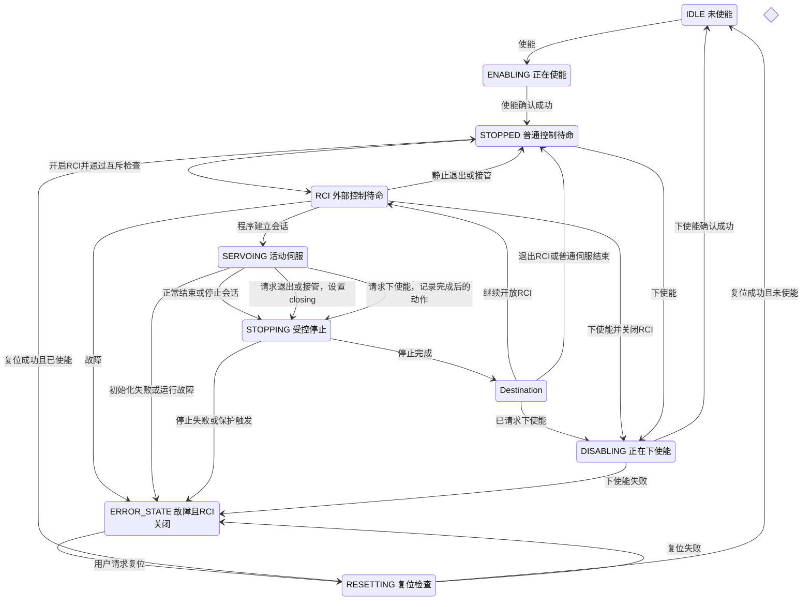
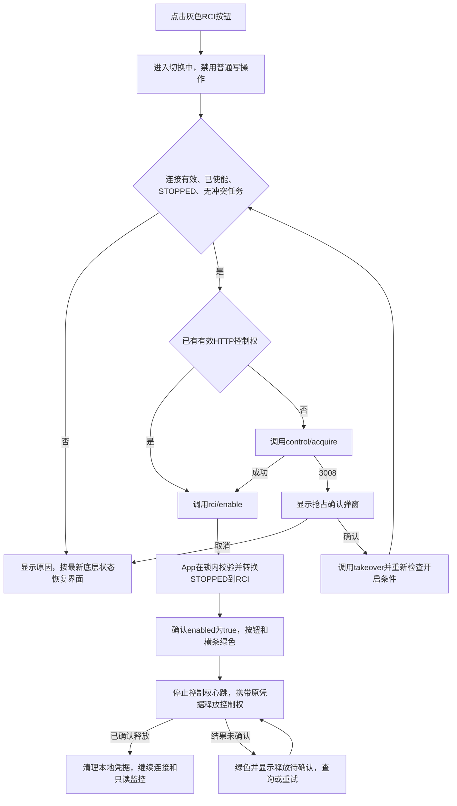
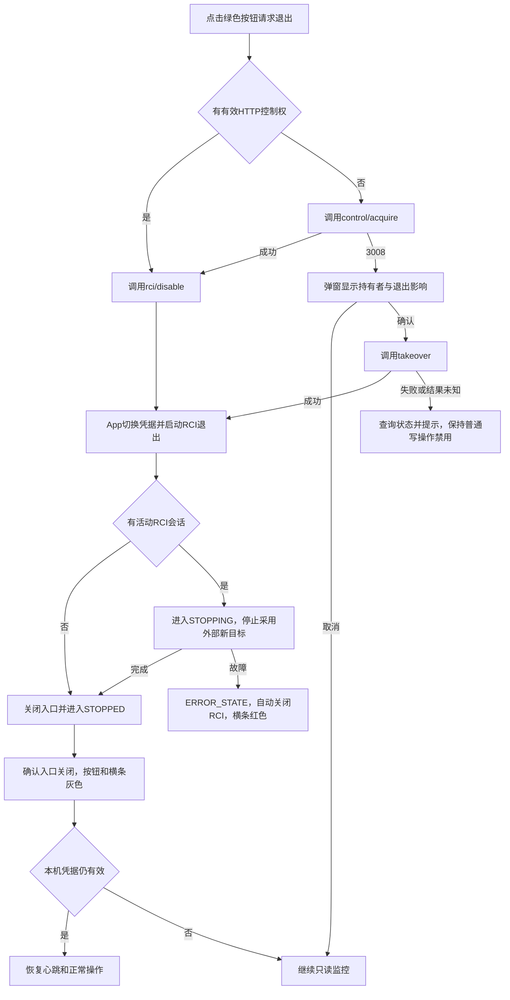

# RCI 待命状态、控制权交接与 Viz 界面详细方案

## 1. 文档状态与核对基线

本方案依据已经确认的交互要求、App 与 Viz 当前源码，以及本次刷新的 Apifox 在线接口编写。文中的目标状态、接口调整和测试项用于后续实现验收。

| 项目 | 本次核对结果 |
| --- | --- |
| 核对日期 | 2026-11-11，Asia/Shanghai |
| App | `v3` 分支，`ce59e55`，版本 `3.2.0-rc.12` |
| Viz | `v3` 分支，`83b7d64`，package 版本 `3.1.0-rc.10` |
| Viz 工作区 | 已有 5 个文件包含未提交的 RCI 类型、状态接收、接口方法和只读拦截改动 |
| Apifox | 项目 `8387612`，模块 `7912103`，`info.version=3.0.0` |
| 在线刷新时间 | `2026-11-11T14:34:04.930Z` |
| Apifox 分支 | 本次 MCP 返回内容未提供分支标识，实施同步时需要核对实际目标分支 |
| 本次验证层级 | 在线契约与源码静态核对，运行验收安排见第 13 节 |

已通过 MCP 刷新并读取 RCI 五个接口、控制权六个接口、机器人状态、使能、下使能、复位、等待运动、运动状态、普通伺服启动与停止、MoveJ、MoveL、脚本运行，以及相关响应模型和鉴权模型。在线定义继续作为接口权威来源，本文件维护设计决策与变更说明。[Apifox ROCOS API](https://app.apifox.com/project/8387612)

## 2. 已确认需求

1. Viz 增加 RCI 开关按钮和状态横条。
2. RCI 开启时按钮和横条为绿色，关闭后为灰色。故障横条为红色，红色优先于普通模式颜色。
3. 开启 RCI 要求机器人已使能、处于 `STOPPED`，且没有活动脚本或冲突任务。
4. 开启成功后 Viz 释放 HTTP 控制权，保持网络连接、模型显示、关节与位姿更新、故障与日志读取，进入只读监控。
5. RCI 开启期间允许程序建立 UDP 伺服会话。MoveJ、MoveL、点动、脚本启动和普通伺服等竞争入口继续受限。
6. RCI 开启期间允许接管，包括正在运动时。接管发起受控停止，退出 RCI 后上位机恢复操作。
7. 控制权被其他客户端持有时，Viz 必须弹窗确认后才能发送抢占请求。
8. `ERROR_STATE` 由 App 自动关闭 RCI、撤销会话、保留故障诊断。Viz 显示红色横条，并继续读取状态。
9. 增加独立 `RCI` 待命状态。正常伺服会话结束后返回 `RCI`，关闭入口后返回 `STOPPED`。
10. 保留现有 API 路径及 RCI 状态字段，减少内部重复状态维护，并配套调整 librocos 的状态判断。
11. 实现遵循最小修改原则，App 与 C++ 测试单核编译，完成自动化、界面和集成验证后形成报告。

## 3. 现有实现与主要差异

### 3.1 App

| 当前实现 | 目标调整 | 影响 |
| --- | --- | --- |
| `EnableRci()` 在 `STOPPED` 中设置 `rci_enabled_` | 显式检查使能，再触发 `STOPPED → RCI` | 运动状态与外部控制待命含义一致 |
| `StartRciControl()` 要求 `STOPPED` | 改为要求 `RCI`，并检查无会话、未关闭 | 新状态下程序能够接入 |
| 伺服成功结束及停止完成统一返回 `STOPPED` | 根据会话归属和退出意图区分 `RCI`、`STOPPED`、下使能流程 | 正常结束后继续开放 RCI |
| `IsControlActive()` 尚无 `RCI` | 增加 `RCI` | 控制线程持续执行位置保持 |
| `IsMotionBusy()` 仅将 `STOPPED` 排除 | 将 RCI 待命也判为无活动运动 | `WaitMove()` 可以在待命时完成 |
| `on_fsm_stopped()` 保存伺服诊断并切换 `MoveHold` | RCI 待命入口复用同等终态处理 | 保持最终参考并完成线程与会话清理 |
| `FinishRciControl()` 仅在 `closing` 为真时清除开启标志 | 故障、下使能、明确退出拥有各自终态清理 | 避免故障或下使能后残留绿色状态 |
| `takeover` 在 RCI 开启时返回冲突 | 允许接管，协调凭据切换及 RCI 受控退出 | 支持运动中抢占 |

对应实现集中在状态表、控制循环和 RCI 方法。`IsControlActive()` 直接决定控制线程循环是否继续，新状态必须纳入这一条件。[robot.cpp](/home/rocos/Documents/GitHub/rocos-app/src/robot.cpp)

### 3.2 Viz

当前工作区已有 `RciStatus`、`getRciStatus()`、`enableRci()`、`disableRci()`、`stopRci()`、REST/WebSocket 状态透传，以及 `rci`、`rciBusy` 存储。已有改动应作为后续实施基线。[RobotApiClient.ts](/home/rocos/Documents/GitHub/rocos-viz/src/core/RobotApiClient.ts) · [connectionStore.ts](/home/rocos/Documents/GitHub/rocos-viz/src/stores/connectionStore.ts)

需要补齐以下行为。

- 连接后自动申请控制权的逻辑，应等待有效 RCI 状态再决定是否申请。
- 释放控制权与断开连接分开处理，保留状态轮询和 WebSocket。
- 当前底部停止按钮依赖 token。RCI 只读监控时应通过 `rci/stop` 请求停止。
- 当前只读拦截主要覆盖通用 request 方法。直接使用 fetch 的使能、复位、控制权、工具及脚本等调用需要逐一核对，以统一动作权限。
- RCI 切换中的临时控制权不能提前开放普通运动按钮。
- 设置页已有抢占确认交互，应与 RCI 按钮共用同一确认规则和操作处理。

相关生命周期、底部控制条和设置页分别位于以下文件。[useControllerSession.ts](/home/rocos/Documents/GitHub/rocos-viz/src/hooks/useControllerSession.ts) · [TeachShell.tsx](/home/rocos/Documents/GitHub/rocos-viz/src/components/teach/TeachShell.tsx) · [Settings.tsx](/home/rocos/Documents/GitHub/rocos-viz/src/components/teach/Settings.tsx)

### 3.3 在线契约发现的差异

| 项目 | 当前在线内容 | 需要对齐的内容 |
| --- | --- | --- |
| `RobotStateData.robot_state` | 枚举包含 `STOPPED`、`SERVOING` 等，尚无 `RCI` | 增加 `RCI` |
| RCI 开启与启动 | 开启后仍以 `STOPPED` 为接入前提 | 开启转入 `RCI`，程序从 `RCI` 启动 |
| 抢占 | takeover 页面写无条件覆盖，RCI enable 页面写 RCI 中拒绝抢占 | 统一为 RCI 中允许接管并发起退出 |
| 完整状态 | `data.rci` 与顶层状态目前另行读取 | 运动状态与 RCI 模式信息来自同一受锁快照 |
| 复位 | reset 描述为清故障后重新使能并进入 `STOPPED` | 当前源码会检查硬件使能，可能进入 `IDLE`，需要与返回结果一起核对 |

源码中的 `ResetFault()` 目前只将最终 `STOPPED` 视为成功，而 `on_fsm_resetting()` 存在进入 `IDLE` 的分支。方案采用复位后按实际使能状态返回 `STOPPED` 或 `IDLE`，对应接口成功判定需配套修正，故障复位后由用户重新开启 RCI。[复位实现](/home/rocos/Documents/GitHub/rocos-app/src/robot.cpp:439)

## 4. 状态与会话的数据模型

### 4.1 三个对象分别承担的职责

| 对象 | 职责 | 生命周期 |
| --- | --- | --- |
| 机器人 FSM | 控制运动阶段和允许的操作 | App 运行期间 |
| HTTP 控制租约 | 管理写接口凭据、持有者、TTL 和心跳 | acquire 到 release、过期或 takeover |
| RCI UDP 会话 | 管理 session ID、来源 IP、端口、序号及伺服目标 | rci/start 到停止完成或故障撤销 |

释放 HTTP 控制权后，RCI 入口和活动 RCI 会话继续运行。现有普通 `/servo/start` 会话与 HTTP 租约关联，需要保留其原有撤销语义。当前 `RobotHttpServer::servo_session_` 用于普通伺服，RCI 会话由 `StartRciControl()` 交给 `MoveServo`，实施时应显式保持这一归属边界。[HTTP 会话处理](/home/rocos/Documents/GitHub/rocos-app/src/robot_http_server.cpp)

### 4.2 状态字段保留与内部推导

| API 字段 | 目标含义 | 建议实现来源 |
| --- | --- | --- |
| `robot_state` | 当前 FSM 状态 | 同一次 FSM 快照 |
| `rci.enabled` | RCI 模式仍占用运动入口，包含关闭中的互斥阶段 | RCI 待命状态，或属于 RCI 的活动／停止中会话 |
| `rci.closing` | 已请求退出 RCI，停止后应关闭入口 | 明确的退出意图 |
| `rci.control_active` | RCI 会话尚处于执行或停止生命周期 | RCI 会话上下文与 FSM 阶段 |
| `last_control` | 最近保存的终态伺服诊断 | 停止完成／故障前保存的快照 |
| `current_control` | 当前仍存在的 MoveServo 诊断 | 当前 motion 类型及其诊断 |

新增 RCI 状态后，可以将 `enabled` 和 `control_active` 作为派生结果。内部需有明确的 RCI 会话归属，可由 Robot 持有的 RCI 会话上下文表达。普通伺服也拥有 `ServoSession`，因此单独判断“存在任意 session”不足以推导 RCI 模式。

`control_active` 应依据会话生命周期。开始拒绝新包后，受控停止仍可能持续多个周期，这一阶段仍应报告活动会话。会话有效性 `session.Active()` 与生命周期结束分别处理。

`IsRciEnabled()` 当前为无锁 atomic 读取。若改为派生实现，应先核对所有调用点的锁顺序。为控制修改范围，可以保留仅由状态转换集中更新的 atomic 发布缓存，API 从同一次受锁状态快照构造，减少业务路径直接写入这些标志。[Robot 字段定义](/home/rocos/Documents/GitHub/rocos-app/src/robot.hpp:453)

### 4.3 两个 control_active 的区别

顶层 `data.control_active` 表示机器人控制循环是否处于工作状态。RCI 待命时该字段应为 `true`。嵌套的 `data.rci.control_active` 表示活动 RCI 会话，RCI 待命时应为 `false`。`motion_busy` 在 RCI 待命时为 `false`。

### 4.4 对外可见状态组合

| FSM | rci.enabled | rci.closing | rci.control_active | 页面含义 |
| --- | --- | --- | --- | --- |
| `STOPPED` | false | false | false | 普通控制待命 |
| `RCI` | true | false | false | 绿色，等待程序 |
| `SERVOING`，RCI 会话 | true | false | true | 绿色，程序控制中 |
| `STOPPING`，正常会话结束 | true | false | true | 绿色，停止后继续等待 |
| `STOPPING`，关闭或接管 | true | true | true | 绿色，显示正在退出 |
| `DISABLING`／`IDLE` | false | false | false | RCI 关闭 |
| `ERROR_STATE` | false | false | false | 红色横条，故障锁定 |
| 普通伺服的 `SERVOING`／`STOPPING` | false | false | false | 使用普通伺服状态显示 |

终态字段一次性发布。RCI 待命直接退出时，可在同一个受锁转换中完成关闭，外部无需观察一个短暂的 `closing=true` 状态。

## 5. 机器人状态流转



状态图突出 RCI 相关路径。其余活动状态继续使用现有故障转换。进入 RCI 时继续保持使能和控制线程，等待接入期间尚无 UDP 运动会话，运动包超时从成功建立会话后的既有时点开始计算。

### 5.1 事件与处理表

| 当前状态 | 事件 | 前置条件与动作 | 完成状态 |
| --- | --- | --- | --- |
| `STOPPED` | 开启 RCI | 有效 HTTP 控制权、已使能、无脚本或冲突任务 | `RCI` |
| `RCI` | 重复开启 | 入口已开且未退出，按幂等成功处理 | `RCI` |
| `RCI` | rci/start | 无活动会话，参数有效，接收初始化成功 | `SERVOING` |
| `RCI` | rci/stop | 无会话，幂等成功 | `RCI` |
| `SERVOING` | 正常完成／rci/stop | 开始受控停止，完成后撤销旧会话并保存最终参考 | `STOPPING → RCI` |
| `RCI` | rci/disable | 有效 HTTP 控制权，关闭入口 | `STOPPED` |
| `SERVOING` | rci/disable | 设置关闭意图并请求停止 | `STOPPING → STOPPED` |
| RCI 会话的 `STOPPING` | rci/disable | 将停止去向升级为退出，幂等处理 | 停止后 `STOPPED` |
| RCI 相关状态 | takeover | 切换 HTTP 凭据，锁定退出流程 | 静止时 `STOPPED`，活动时先 `STOPPING` |
| RCI 相关状态 | 下使能 | 关闭入口，活动会话先完成停止 | `DISABLING → IDLE` |
| RCI 相关状态 | 故障 | 关闭入口、保存诊断、撤销会话、执行故障处理 | `ERROR_STATE` |

停止完成事件应按以下优先级确定结果，随后清理退出标志和会话上下文。

1. 发生故障，进入 `ERROR_STATE`。
2. 请求下使能，进入 `DISABLING`。
3. 请求关闭 RCI，进入 `STOPPED`。
4. RCI 会话正常结束，进入 `RCI`。
5. 普通运动或普通伺服结束，进入其既有完成状态。

现有 `EventSuccessed` 和 `EventStopped` 都需覆盖这些分支，包括 `SERVOING` 的完成兜底路径。下使能的延后动作应使用一个明确的待执行标志或目标状态记录，避免停止完成后短暂开放普通运动入口。

## 6. 灰色到绿色的开启流程



### 6.1 开启前

Viz 进入本次操作的 busy 状态，保存目标控制器地址、连接代次和当前凭据。普通 MoveJ、点动、脚本、设置等写操作在切换期间禁用。状态读取与日志更新继续运行。

开启请求携带匹配的 token 和 client_id。App 将鉴权与开启串行，并在 FSM 锁内重新检查使能、`STOPPED`、活动脚本和退出意图，随后触发新事件进入 `RCI`。当前 handler 已串行处理鉴权与开启，可基于现有锁结构实现。[handleRciEnable](/home/rocos/Documents/GitHub/rocos-app/src/robot_http_server.cpp:1251)

### 6.2 开启成功与控制权交接

确认有效状态中的 `rci.enabled=true` 后，按钮和横条变绿。绿色表示底层模式已开启，控制权释放结果另行跟踪。若程序已迅速接入，下一次快照可以直接显示 `SERVOING`，前端仍应完成释放流程。

停止旧控制权心跳后，使用本次捕获的凭据发送 release。确认释放成功、凭据已失效或持有者已改变后，清理本地凭据。旧心跳或旧请求的迟到响应必须按操作代次过滤。

开启成功但 release 结果未确认时，页面保持只读并显示“RCI 已开启，控制权释放待确认”。保留本次释放所需凭据用于核对或重试，避免在错误状态下显示交接已完成。

### 6.3 开启失败或超时

- 明确业务失败时，读取最新状态，并根据实际持有者恢复交互。
- 请求超时时查询 RCI 状态与控制权状态。开启可能已在服务端完成。
- 如果故障发生，优先显示红色。迟到的开启成功响应不得覆盖已确认的故障。
- 如果页面换了控制器地址，旧控制器的响应不得写入新连接状态。
- 切换前发起的轮询响应不得覆盖切换后的确认结果。串行化本次确认查询，使用连接和操作代次过滤旧响应。

## 7. 绿色到灰色、停止与抢占



### 7.1 普通停止与退出

页面的停止入口在 RCI 模式下调用无需 HTTP token 的 `POST /api/robot/rci/stop`，正常完成后回到 `RCI`。绿色 RCI 按钮执行退出流程，通过有效 HTTP 控制权调用 `rci/disable`，正常完成后返回 `STOPPED`。

原地保持的伺服会话属于 `SERVOING`，退出时同样结束会话。前端根据服务端终态恢复操作，即使初始速度为零，也要完成退出与会话撤销。

### 7.2 抢占弹窗

已有其他 HTTP 控制权持有者时，显示以下文案，并使用现有中英文国际化机制。

> **确认抢占控制权并退出 RCI？**
>
> 当前控制权由「客户端名称 · IP」持有。确认后，原持有者的控制凭据将失效，正在运行的 RCI 伺服将停止，并退出 RCI。
>
> **取消**　**抢占并退出 RCI**

开启 RCI 时发生持有者冲突，弹窗按钮使用“抢占并开启 RCI”，正文根据最新状态说明接管影响。确认后重新校验开启条件，等待已发起的停止结束。持有者或连接目标在弹窗显示期间发生已知变化时，刷新信息并重新确认。

取消后继续监控。页面刷新、重连、请求失败重试和故障通知均不能代替确认动作。HTTP 租约持有者与 UDP 程序可能不同，弹窗中分别使用“HTTP 控制权持有者”和“活动 RCI 会话”描述。

弹窗是 Viz 交互约束，服务端按照公开接口执行 takeover。其他程序调用 takeover 的行为继续由该接口契约定义。

### 7.3 App 接管事务

建议复用 `POST /api/control/takeover`。RCI 已开启时，该调用同时发起 RCI 退出，避免依赖浏览器随后一定能送达第二个关闭请求。

受锁操作中完成以下工作。

1. 读取当前模式和会话，验证请求格式。
2. 作废旧 HTTP 凭据并生成新租约。
3. 若处于 RCI 模式，设置关闭意图，禁止新接入，活动会话进入正常受控停止。
4. 返回新的 `ControlOwnerData`。响应成功表示控制权已经取得，停止完成通过状态查询确认。

如果取得控制权后停止处理触发故障，保留新租约用于故障处理，底层进入 `ERROR_STATE` 并关闭 RCI。停止错误通过状态和故障诊断报告，避免返回一个无法被调用方正确保存的新 token。

普通 acquire 继续只负责颁发租约。Viz 的正常退出在 acquire 成功后调用 disable。该间隙允许状态变化，disable 在锁内检查并处理当前实际状态，因此能覆盖期间新接入的会话。

takeover 响应丢失时，`control/status` 可以确认持有者和租约状态，但其响应不会返回新 token。若本次新凭据未收到，页面应提示接管结果待确认，并由用户明确确认重试接管或等待租约恢复到可申请状态。同一 client_id 不能替代缺失的 token，后台轮询不自动重发 takeover。

### 7.4 包处理和撤销顺序

正常退出先调用现有 `MoveServo::Stop()` 进入 `stopping_`，后续目标不再推进正常跟踪，制动参考由已验证停止逻辑生成。会话最终结束后销毁接收器、撤销 session，并保留终态诊断。

当前未进入停止流程时将 session 置为无效，会被检测为 `LostHeartbeat`。接管顺序必须避免把正常接管记为通信故障。实际发生的保护故障继续保留原故障原因。[MoveServo 停止及会话检查](/home/rocos/Documents/GitHub/rocos-app/src/move_servo.cpp)

## 8. 故障、下使能与重连

### 8.1 故障退出

`on_fsm_error()` 在同一状态转换中关闭入口、清除退出意图、保存故障诊断并结束 RCI 生命周期。受控停止失败、IK/反馈/通信保护错误和硬件故障继续进入原有故障处理路径。

模式关闭与硬件故障处置由 App 执行。Viz 根据最新故障状态显示红色，并持续读取。错误初始化时已有的首次 `ERROR_STATE` 入口特殊处理需要保留，避免将构造阶段记录为运行故障。

复位需要有效 HTTP 控制权。控制权被其他客户端持有时仍经过抢占确认。故障清除后根据硬件实际状态进入 `STOPPED` 或 `IDLE`，再次开启 RCI 由用户或程序显式发起。

`last_control` 可以继续保留历史故障用于诊断。横条颜色依据当前有效 FSM 状态，复位成功后历史故障记录不会单独将横条重新置红。

### 8.2 下使能

RCI 待命时可以关闭入口并进入 `DISABLING`。活动伺服请求下使能时记录停止后的下使能动作，先完成现有受控停止，再执行下使能确认。停止或下使能失败按故障路径处理。全局下使能仍使用原有鉴权接口。

### 8.3 Viz 断线和重连

断线后按钮显示灰色禁用并标注“状态未知”，普通操作禁用。再次连接后先获取新鲜状态。检测到 RCI 开启就进入只读监控，检测到关闭才按原有连接流程处理控制权。

若刷新后恢复了同一标签页保存的有效凭据，并且底层处于 RCI 模式，应继续完成释放流程。已经明确由本次用户操作发起的退出流程可以先核对终态。状态读取不会续租，需要根据“继续释放”或“保留用于退出”明确处理恢复的凭据。

## 9. API 变更清单

现有路径足以完成本次功能。下表列出当前契约与拟调整内容，实施时按最新在线版本局部更新。

| 接口 | 鉴权 | 拟调整 |
| --- | --- | --- |
| `POST /api/robot/rci/enable` | token 与 client_id 同时提供 | 增加显式使能条件，成功进入 `RCI`，说明 HTTP 租约释放后的行为 |
| `POST /api/robot/rci/start` | 当前无需 HTTP 控制租约 | 接入前提改为 `RCI`，新会话进入 `SERVOING`，失败按原故障策略处理 |
| `POST /api/robot/rci/stop` | 当前无需 HTTP 控制租约 | 正常完成进入 `RCI`，关闭过程中不会取消退出意图 |
| `POST /api/robot/rci/disable` | token 与 client_id 同时提供 | 静止时直接 `RCI → STOPPED`，活动时先 `STOPPING`，终态查询确认 |
| `GET /api/robot/rci/status` | 只读 | 明确 `RCI` 状态、派生字段、关闭中状态和故障清理结果 |
| `POST /api/control/acquire` | 当前无需既有 token | 继续按空闲租约申请，已有持有者返回 3008 |
| `POST /api/control/release` | token 与 client_id 同时提供 | 明确释放 HTTP 租约后 RCI 入口及 RCI 会话继续运行 |
| `POST /api/control/takeover` | 当前无需既有 token | RCI 中允许执行，旧 HTTP 凭据失效，同时锁定并启动 RCI 退出 |
| `GET /api/control/status` | 只读 | 继续用于持有者、TTL 和交接结果核对 |
| `POST /api/control/heartbeat` | token 与 client_id 同时提供 | 切换期间按当前操作意图暂停或恢复续租 |
| `GET /api/robot/state` | 只读 | 状态枚举增加 `RCI`，运动状态与 RCI 字段来自同一次状态快照 |
| `GET /api/robot/move_status` | 只读 | 说明 RCI 待命的控制循环活跃与运动空闲含义 |
| `POST /api/robot/wait_move` | token 与 client_id 同时提供 | RCI 待命可按运动空闲返回 |
| `POST /api/robot/disable` | token 与 client_id 同时提供 | 补充 RCI 待命及活动会话的下使能流转 |
| `POST /api/robot/reset` | token 与 client_id 同时提供 | 对齐复位后可能进入 `STOPPED` 或 `IDLE` 的实际行为和返回结果 |
| 普通 `/servo/*`、MoveJ、MoveL、脚本运行 | 沿用各接口鉴权 | 描述 RCI 期间的竞争入口拒绝规则 |

模型修改涉及 `RobotStateData`、`RciStatusData`、`MoveStatusData` 及相关响应示例。`RciResponse`、`RciStartResponse` 和 `ControlOwnerData` 保留其已有结构，继续通过 `success`、`code` 和 `message` 判断业务结果。

继续使用已核实的错误码，例如缺少控制权 3006、凭据无效 3007、已有持有者 3008、状态冲突 -2215、RCI 未开启 -1018、UDP 初始化错误 -1016/-1017。新增使能前置检查优先复用代码中的 `NotEnabled`，具体数值应在实现时核对并写入在线契约。

## 10. App 实现方案

### 10.1 状态机和保持参考

- 新增 `RCI` 状态及开启、关闭相关事件。外部事件沿用 `LockToolState()` 与 FSM 锁保护。
- `GetStateString()` 返回 `RCI`。快照构建一次读取相关状态，避免多次跨转换读取。
- `IsControlActive()` 包含 RCI 待命。`IsMotionBusy()` 将 RCI 待命判为运动空闲。
- 新增 RCI 待命入口处理，复用停止完成后的诊断保存、会话结束和 `MoveHold` 构造。
- 从 `STOPPED` 开启 RCI 时沿用现有保持参考。从伺服结束返回 RCI 时使用最后有效伺服参考，避免重新锚定实际反馈产生累计偏移。
- 根据退出意图处理 `EventStopped`、`EventSuccessed` 和已有完成兜底路径。
- `StartRciControl()` 先准备会话上下文，再触发 RCI 到 SERVOING 的事件。返回前校验实际初始化结果，失败路径清理上下文。

### 10.2 并发与锁

现有 HTTP handler 通常按控制权锁、命令锁、FSM 锁、运动对象锁的方向访问。实现需对照实际调用链核验这一顺序，尤其是从持有运动对象锁的路径调用新派生状态查询的情况。

停止请求采用短时受锁操作，等待停止完成由后续状态查询完成。网络等待、线程回收和磁盘访问应避免放在需要实时控制线程取得的锁内。故障处理继续拥有独立于 Viz 的执行能力。

takeover、rci/start、rci/disable、脚本启动和普通运动启动使用同一命令互斥边界。退出意图一旦提交，后来的 rci/start 必须返回冲突。先成功接入的会话由随后退出请求负责停止。

### 10.3 统一状态快照

`robot_state`、顶层 `control_active`、`motion_busy` 与 `data.rci` 在一次受锁读取中形成。`GetRciStatus()` 复用相同的状态读取逻辑。实现可以将 RCI 状态加入现有 `RobotStateSnapshot`，避免 HTTP handler 在顶层快照之后另读模式。

这一调整针对状态机信息的一致性。关节反馈和周期伺服诊断继续按各自现有采样语义提供，文档中明确各字段时间口径。

## 11. Viz 实现方案

### 11.1 按钮与横条

RCI 开关置于现有使能／机器人状态区域附近，横条放在页面公共区域，跨路由持续可见。使用当前主题、组件和国际化体系。

| 状态 | 按钮 | 横条及文字 |
| --- | --- | --- |
| 有效连接，RCI 关闭 | 灰色，根据开启条件决定可点击性 | 灰色，RCI 已关闭 |
| `RCI` 待命 | 绿色 | 绿色，等待程序接入 |
| RCI `SERVOING` | 绿色 | 绿色，外部程序控制中 |
| RCI 正常停止 | 绿色，操作按 busy 状态管理 | 绿色，正在停止 |
| RCI 退出中 | 绿色加载态 | 绿色，正在退出 RCI |
| 开启成功但释放未确认 | 绿色加载态 | 绿色，控制权释放待确认 |
| `ERROR_STATE` | 底层确认关闭后灰色禁用 | 红色，显示故障及诊断入口 |
| 状态未知或连接丢失 | 灰色禁用 | 状态未知，显示连接提示 |

颜色附带文字和图标。故障优先级高于普通开启结果，收到新的有效状态后再更新模式颜色。

### 11.2 权限与生命周期

建立统一的界面操作条件，覆盖按钮、快捷键、脚本、拖动和直接 API 方法。普通写操作要求有效连接、有效租约、RCI 已关闭、本地切换结束及对应运动状态允许。RCI 中保留状态、日志、停止和用户明确触发的退出／接管动作。

只读动作表需包含原有无硬件写入的运动预览。临时持有 token 的退出阶段继续禁止真实运动写操作。异常处理清理 busy 时，也要依据底层模式与租约有效性决定普通操作是否恢复。

连接生命周期至少区分初次状态确认、普通控制、RCI 监控和切换中。已有 `rciBusy` 可以继续用于交互禁用，异步执行还应保存本次操作意图及连接代次，便于处理释放重试、退出等待和迟到响应。

### 11.3 文件级修改建议

| 文件 | 修改内容 |
| --- | --- |
| `src/core/types.ts` | 完整 RCI 类型、状态枚举及诊断字段 |
| `src/core/RobotApiClient.ts` | 完善已有 RCI 方法、业务错误保留和只读动作约束 |
| `src/core/RobotWebSocket.ts` | 对齐统一状态快照映射 |
| `src/stores/connectionStore.ts` | 维护模式、操作阶段、连接代次和凭据生命周期 |
| `src/hooks/useRobotConnection.ts` | 状态新鲜度、旧响应过滤、断线状态清理 |
| `src/hooks/useControllerSession.ts` | 开启、释放、申请、确认抢占、退出等待和重连协调 |
| `src/components/teach/TeachShell.tsx` | RCI 开关、公共横条、停止按钮路由和普通操作禁用 |
| `src/components/teach/Settings.tsx` | 复用统一抢占确认规则 |
| `src/i18n/index.ts` 及对应样式 | 中英文文案、颜色和处理中反馈 |

## 12. librocos 与兼容性

当前 SDK 的 `finishSession()` 已根据会话结束、非 STOPPING、非 closing 判断完成，可以在实现后验证其对 `RCI` 的兼容性。示例的 `prepare()` 和部分结束检查直接要求 `STOPPED`，需要接受 RCI 待命并验证会话已经结束。[SDK 会话结束](/home/rocos/Documents/GitHub/rocos-app/librocos/src/robot.cpp) · [示例公共准备逻辑](/home/rocos/Documents/GitHub/rocos-app/librocos/examples/common.hpp)

客户端读取已有 RCI 开启状态后可直接接入。重复 enable 应按有效开启状态幂等处理。程序自行开启 RCI 时继续按获取 HTTP 控制权、enable、release 的现有流程运行。

新增 `robot_state=RCI` 会影响硬编码 `STOPPED` 的旧客户端，部署需配套更新这些判断。UDP v2 会话、来源、序号、周期响应、首点检查、反馈保护和通信保护继续使用现有协议与算法。

## 13. 验证与验收

### 13.1 自动化测试矩阵

| 编号 | 场景 | 必须验证的结果 |
| --- | --- | --- |
| A01 | 未使能、非 STOPPED、活动脚本时开启 | 明确拒绝，原状态及持有者关系正确 |
| A02 | 正常开启、重复开启 | 进入 RCI，重复请求幂等，控制线程持续工作 |
| A03 | RCI 待命超过首包超时时长 | 持续保持，尚无会话时不会因无 UDP 运动包触发会话超时 |
| A04 | 程序接入及初始化失败 | 成功进入 SERVOING，绑定等失败保留具体错误并关闭故障会话 |
| A05 | 正常结束及反复启停 | 每次返回 RCI，旧会话撤销，保持参考连续 |
| A06 | RCI 中 MoveJ／MoveL／点动／脚本／普通伺服 | HTTP 和直接 Robot 路径均拒绝竞争入口 |
| A07 | HTTP release 或租约到期 | RCI 入口及 RCI 会话按独立生命周期运行 |
| A08 | 普通伺服的 release／takeover／过期 | 保留原有普通会话撤销行为 |
| A09 | RCI 静止退出及运动中退出 | 终态 STOPPED，关闭标志、会话和线程一致 |
| A10 | 确认抢占 | 旧 token 失效，新 token 可用，受控停止完成后关闭 RCI |
| A11 | 取消抢占、重复点击、弹窗期间状态变化 | 取消后零 takeover 请求，重复操作受控，重新确认条件正确 |
| A12 | 抢占与 start 并发 | 同一时刻最多一个会话，退出提交后拒绝新接入 |
| A13 | 正常停止中追加退出或下使能 | 完成去向正确，后到请求不能重新打开入口 |
| A14 | 保护故障、停止失败、下使能失败 | ERROR_STATE，RCI 关闭，旧包失效，最终诊断可查 |
| A15 | 复位后硬件使能与未使能两种情况 | 分别 STOPPED、IDLE，结果与接口说明一致 |
| A16 | RCI 待命的 WaitMove 和状态查询 | 顶层 control_active=true，motion_busy=false，rci.control_active=false |
| V01 | 灰到绿完整流程 | enable 成功后释放凭据，连接和状态刷新连续 |
| V02 | 开启响应丢失、释放响应丢失 | 查询服务端恢复事实，页面保持正确权限 |
| V03 | 释放失败但 RCI 已开启 | 绿色待确认，持续只读，保留重试所需凭据 |
| V04 | 程序快速接入 | 直接读到 SERVOING 仍能完成开启交接 |
| V05 | RCI 监控状态点击停止 | 使用 rci/stop，无 token 时仍可执行 |
| V06 | 错误发生与旧响应迟到 | 红色故障优先，旧响应无法重新开放控制 |
| V07 | 刷新、断线、重连、切换控制器地址 | 首次状态确认后决定权限，旧连接响应被过滤 |
| V08 | 中英文及不同页面入口 | 按钮、横条、弹窗和错误提示一致 |
| C01 | 更新后的 librocos 与普通伺服客户端 | RCI 重复接入正常，原有非 RCI 路径回归通过 |

现有 App 测试主要扩展 `servo_robot_test.cc`、`move_servo_test.cc`、`librocos_test.cc` 和 Lua 互斥相关测试。Viz 在现有 Node 与 Playwright 测试中覆盖上述状态和网络结果。

### 13.2 构建与执行计划

App 使用目标环境现有的 CMake 构建目录，以单核方式编译受影响目标。示意命令适用于 release 构建目录存在且配置有效的环境。

```bash
cmake --build build/release --target rocosAppMain servo_robot_test move_servo_test lua_script_engine_test -j1
ctest --test-dir build/release -R '^(servo_robot_test|librocos_robot_test|move_servo_test|lua_script_engine_test)$' --output-on-failure -j1
cmake --build build/librocos-standalone --target librocos_test -j1
ctest --test-dir build/librocos-standalone --output-on-failure -j1
```

Viz 按项目脚本串行执行构建及测试，浏览器验收使用一个 worker。

```bash
npm run build
npm run test:control
npm run test:script
npm run test:teach
npm run test:ui -- --workers=1
```

随后使用准备好的仿真环境验证状态与 HTTP 交接，再进行原地伺服会话的进入、停止和接管测试。最终报告记录环境、命令、通过项、失败项、终态快照、状态转换日志和界面截图。

## 14. 实施顺序与完成标准

1. 对照实施当日的最新 Apifox 和两个仓库状态复核本方案，保留现有工作区改动。
2. 完成 App 状态、会话归属、退出意图与快照的最小调整，并通过离线测试。
3. 完成 HTTP 抢占和退出协调，补充并发、故障及普通伺服回归。
4. 配套更新 librocos 示例的 RCI 待命判断。
5. 完成 Viz 按钮、横条、只读生命周期、停止入口及确认弹窗。
6. 按接口修改清单更新 Apifox，通过 MCP 再次刷新并回读相关操作、状态模型、鉴权和示例。
7. 完成构建、自动化与集成验收，形成实际测试报告。

完成标准包括状态流转与三个 RCI 字段一致、开启后控制权释放且状态读取连续、抢占必经确认、正常接管受控停止、故障自动关闭、旧凭据及旧 UDP 会话失效，以及在线契约与实现一致。

本次产物为经过现有接口与源码核对的实施方案。文档中的目标行为、构建命令和测试矩阵用于后续执行记录，运行结果以实施阶段生成的测试报告为准。


## 15. 本地实施记录

2026-11-12 已按本方案实施本地 App、Viz 与 librocos 示例兼容调整，并同步 Apifox。实施时 App 基线已更新为 `226a8b0`、3.2.0-rc.13。具体改动、验证范围和扩展回归中发现的问题见 [RCI 本地实施报告](rci_state_machine_and_viz_implementation_report.md)。
