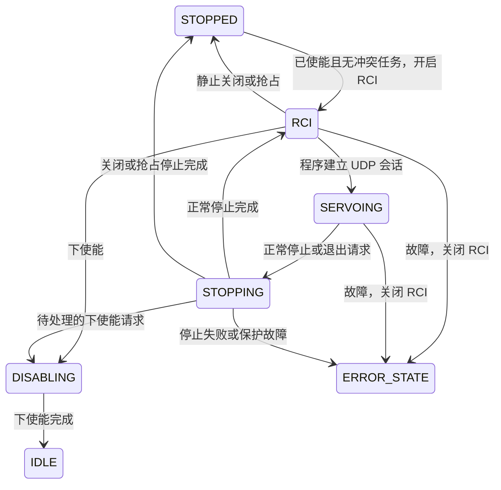

# RCI 状态机与 Viz 本地实施报告

## 实施环境

实施日期为 2026-11-12，时区 Asia/Shanghai。

| 项目 | 环境 |
| --- | --- |
| App | `/home/rocos/Documents/GitHub/rocos-app`，`v3`，HEAD `226a8b0`，3.2.0-rc.13 |
| Viz | `/home/rocos/Documents/GitHub/rocos-viz`，HEAD `83b7d64`，3.1.0-rc.10 |
| C++ 构建 | 现有 `build/`，Release，Unix Makefiles，全部使用 `-j1` |
| 前端验证 | TypeScript、Vite、Node 测试、Chrome Playwright，浏览器测试使用一个 worker |
| 控制器验证 | 测试程序创建的离线主站及 TCP/UDP 协议对端 |
| 远端主机 | 本次没有连接或操作远程 App，代码、配置和进程均未改动 |

首轮实施和验证以工作区已有的反馈保护、六轴示例及 Viz RCI 接口改动为基线。以下首轮结果记录该工作区的验证情况。本次内部提交另按 RCI 范围拆分，并在隔离副本中验证，提交范围和结果见文末。首轮构建产物位于 `build/bin/`，Viz 产物位于其仓库的 `dist/`。

方案依据见 [RCI 状态机与 Viz 实施方案](rci_state_machine_and_viz_design.md)。

## 已完成行为

### App

- 增加独立 `RCI` 待命状态，开启需要硬件已使能、FSM 为 `STOPPED`，且没有活动脚本。
- `RCI` 待命继续执行位置保持，顶层 `control_active=true`、`motion_busy=false`，RCI 会话 `control_active=false`。
- 正常伺服停止返回 `RCI`。关闭入口或 HTTP 抢占请求提交退出意图，活动会话完成受控停止后进入 `STOPPED`。
- RCI 待命可以直接下使能。活动会话先停止，再下使能进入 `IDLE`。停止中的下使能意图优先于返回待命。
- `ERROR_STATE` 自动清除 RCI 模式、退出意图和会话归属，撤销旧 UDP 会话并保留诊断。
- RCI 会话使用独立上下文。释放或过期的 HTTP 租约保持现有 RCI 会话生命周期，普通 `/servo/start` 会话继续受 HTTP 租约约束。
- 抢占在命令锁内转移 HTTP 租约并提交 RCI 退出。旧 HTTP token 失效，新 token 可以用于状态确认及故障复位。
- `RobotStateSnapshot` 同时读取 FSM 状态、控制活跃、运动忙和 RCI 字段。HTTP 状态响应使用这一快照。
- 复位成功判定接受实际硬件状态对应的 `STOPPED` 或 `IDLE`。

内部保留 `rci_enabled_` 作为 FSM 转换时发布的缓存，供已有无 FSM 锁读取入口使用。`control_active` 从 RCI 会话上下文推导，`closing` 表示明确退出意图，下使能另有待处理标志。三个现有 API 字段继续保留。



主要实现位于 `src/robot.cpp`、`src/robot.hpp` 和 `src/robot_http_server.cpp`。librocos 公共示例准备逻辑、正弦示例结束判断和协议测试对端已配套接受 `RCI` 待命。

### Viz

RCI 开关位于底部控制条的使能按钮附近，状态横条位于顶部公共区域。

| 场景 | 页面行为 |
| --- | --- |
| RCI 关闭 | 灰色按钮和横条，依据使能及 STOPPED 条件允许开启 |
| 开启成功 | 释放捕获的 HTTP token，保持连接、状态读取和模型显示 |
| RCI 待命或伺服 | 绿色按钮和横条，普通写操作禁用 |
| 释放待确认 | 显示等待提示，暂停续租，持续只读并重试释放 |
| 点击退出 | 申请或验证 HTTP 控制权，然后请求关闭并等待停止完成 |
| 控制权被占用 | 弹窗显示持有者和 IP，明确确认后调用 takeover |
| 取消弹窗 | 不发送 takeover，继续监控 |
| RCI 中点击停止 | 调用无需 HTTP token 的 `rci/stop` |
| ERROR_STATE | 红色横条，RCI 按钮灰色禁用，可通过控制权入口取得权限用于复位 |
| 重新连接到 RCI | 优先读取模式，保持只读，释放恢复出的旧凭据 |

普通写操作同时受到界面权限和 API 客户端校验约束，覆盖通用请求、复位、工具导入和 URDF 上传。预览、状态及日志读取继续可用。连接代次用于阻止旧连接的异步操作更新当前连接。HTTP 轮询接管后忽略旧 WebSocket 的迟到状态。

主要新增文件为 `src/hooks/useRciControl.ts`、`src/components/control/RciStatus.tsx`。其余改动集中在会话钩子、连接存储、公共控制条、设置页、国际化和现有写操作权限选择。

## Apifox 契约同步

项目为 `8387612`，模块为 `7912103`。通过 MCP 刷新与读取后，使用此前授权的官方 API 更新默认主分支，再通过 MCP 刷新回读。MCP 本身未返回分支 ID。API 版本保持 `3.0.0`。

更新涉及 RCI 五个接口、takeover、robot/state、disable、reset、wait_move、move_status、MoveJ、MoveL 和 script/run，共 14 个接口，以及 `RobotStateData`、`RciStatusData` 两个模型。

回读确认了以下内容。

- `robot_state` 新增 `RCI`。
- 开启、启动、正常停止、关闭、抢占、故障和复位的状态语义与本次实现一致。
- 受保护接口仍要求 ControlToken 与 ClientId 同时提供。
- RCI start、stop、status 保持各自已有的无 HTTP 控制凭据契约。
- 全项目路径集合仍为 82 条，模型集合仍为 56 个。无关路径内容与更新前一致。
- 导入器自动改变过鉴权模型的目录元数据，已经恢复并再次核对，鉴权定义及目录元数据与更新前一致。

在线定义可在 [Apifox ROCOS API](https://app.apifox.com/project/8387612) 查看。

内部提交前再次按 `rocos-api-maintenance` 流程刷新并读取接口与响应模型。发现 `/api/robot/state` 的说明仍包含旧的“RCI 状态另行读取”段落，同时末段说明 FSM 和 RCI 来自同一次受锁读取，两段存在冲突。本次实现与新增的同锁读取说明一致，旧说明待单独清理。

## 构建和测试

### 已通过的核心验证

| 验证 | 结果 |
| --- | --- |
| App、伺服测试、Lua 测试和 librocos 示例／测试单核编译 | 通过 |
| `servo_robot_test` | 26 个用例通过，3229 个断言通过 |
| `librocos_robot_test` | 2 个用例通过，40 个断言通过 |
| `librocos_test` | 22 个用例通过 |
| Viz `npm run build` | 通过 |
| Viz `test:control` | 7 个测试通过 |
| Viz `test:script` | 10 个测试通过 |
| Viz `test:teach` | 5 个测试通过 |
| RCI 浏览器交互 | 7 个专项测试通过，包含中英文及深浅主题检查 |
| Viz 全量浏览器回归 | 88 项中 87 项通过，含修正定位器后的复跑；1 项模型缓存加载超时 |

App 核心用例覆盖 RCI 待命与幂等开启、会话来源和端点约束、竞争入口拒绝、HTTP 租约释放／过期、正常停止、初始化失败、故障自动退出、活动会话关闭、下使能、旧 token 失效、新 token 可用、300 次反复启停，以及 20 次接入与抢占并发。

librocos 离线主站测试包含重复会话接入、UDP 周期响应和微小正弦参考跟踪。测试环境无法取得所请求的实时调度权限，日志记录了 SCHED_OTHER 回退，因此本次结果用于状态和协议回归。

```bash
cmake --build build --target rocosAppMain servo_robot_test move_servo_test lua_script_engine_test librocos_test -j1
ctest --test-dir build -R '^(servo_robot_test|librocos_robot_test|librocos_test)$' --output-on-failure -j1
```

### 扩展回归中发现的问题

| 用例／套件 | 现象 | 本次判断 |
| --- | --- | --- |
| `Servo regression small targets converge without self-excited motion` | 小阶跃目标的输出超出用例要求的收敛包络 | 用例直接调用 ServoSignalProcessor，未经过 RCI 状态机 |
| `Servo adaptive tracking settles repeated small targets and reversals` | 小目标与反向目标的收敛断言失败 | 用例直接调用 Model 限速函数，未经过 RCI 状态机 |
| `lua_script_engine_test` | 11 个用例均在初始化时报 `bad file: hardware_talon_config.yaml` | 当前独立测试缺少其依赖的硬件配置，未完成该套件运行验证 |

`move_servo_test` 为 53 个用例通过、2 个用例失败。本次修改集中于状态机、会话交接、界面及 SDK 状态兼容，以上限速计算算法沿用进入本次任务时的工作区实现。报告保留这些失败，不能据此宣称全部伺服回归通过。RCI 与 Lua 的互斥行为另由已通过的离线 `servo_robot_test` 覆盖。

后续隔离复测确认，两项限速失败已存在于提交 `3eaa841`，当前 Model 实现与 RCI 修改前的 `226a8b0` 一致。仅在隔离副本中换回 `3eaa841` 前的 Model 跟踪律，两项测试均通过。J=150 的固定 0.00297 rad 目标在当前算法下会产生约 ±0.55 rad 的持续振荡，首次超调断言不足以反映完整行为。J=10000、1 ms、100 Hz 低通的同一目标最终收敛，峰值仍达到 0.00506 rad。参考恢复与收敛改进仍处于分析阶段，本次 RCI 提交沿用现有限速实现。

本次验证未执行真机运动或 MuJoCo 在线运动。远程 App 由用户保持管理。实际部署后的硬件停止效果、断电响应和连续运动需要在对应设备上验收。

测试日志汇总位于 [本地验证目录](/home/rocos/Documents/GitHub/rocos-app/build/rci-state-machine-validation)。


### 浏览器回归说明

完整浏览器回归首轮为 84 项通过、4 项失败。新增 RCI 状态横条后，原有两个通过全页面 `role=status` 定位的测试命中了两个状态区域。已将这两个测试限定到主内容区，复跑通过。英文页面加载等待用例复跑通过。

剩余模型缓存用例 `one connection downloads its model once across overview, teaching and execution` 在本地出现模型 ready 等待或切页后的几何对象等待超时。使用 `git archive HEAD` 导出的原始 Viz `83b7d64` 在独立临时目录、独立 Vite 端口运行同一用例，也在等待模型 ready 时超时。该对照记录支持将其列为模型加载／测试环境问题，具体根因尚未定位。

验证过程还修复了新增状态横条引起的英文横屏空间挤压。低高度布局允许主内容滚动，中英文 7 组视口检查复跑均通过。底部停止控制保持独立可见。


### RCI 专项浏览器结果

7 项专项测试覆盖灰到绿、释放后保持连接、普通写操作禁用、只读停止、退出重新取得控制权、抢占确认与取消、释放失败自动重试、已开启 RCI 的重连、恢复凭据释放、故障红条，以及开启和释放响应丢失后的查询恢复。另检查了非 STOPPED 时禁止开启。

截图保存在验证目录下。

- [RCI 绿色待命横条](../build/rci-state-machine-validation/screenshots/rci-ready.png)
- [英文深色主题](../build/rci-state-machine-validation/screenshots/rci-ready-dark-en.png)
- [抢占确认弹窗](../build/rci-state-machine-validation/screenshots/rci-confirm.png)
- [故障红色横条](../build/rci-state-machine-validation/screenshots/rci-error.png)


## 内部测试提交验证

本次按用户指定的内部测试类型更新版本。

| 仓库 | 版本变化 | 提交范围 |
| --- | --- | --- |
| App | 3.2.0-rc.13 → 3.2.0-rc.14 | RCI 状态机、HTTP 抢占、状态快照、SDK 示例状态兼容、对应测试和文档 |
| Viz | 3.1.0-rc.10 → 3.1.0-rc.11 | RCI 开关与横条、连接只读、控制权交接与抢占确认、对应测试 |

App 工作区中的六轴示例扩展、型号配置及反馈跟随保护调整保留为独立未提交改动。三个同时包含其他修改的文件按 RCI 片段暂存。源码中现有低通和限速计算沿用父提交，本次没有实施后续讨论的收敛恢复算法。App 和 Viz 需要配套处理新增的 RCI 状态。

App 从暂存树导出到 `/tmp/rocos-rci-rc14`，使用相同依赖安装前缀完成 Release 单核编译。验证覆盖 `rocosAppMain`、`servo_robot_test`、`librocos_test`、`move_servo_test` 及 SDK 示例。生成头文件确认版本为 3.2.0-rc.14。

| 隔离提交验证 | 结果 |
| --- | --- |
| `servo_robot_test` | 26 个用例通过 |
| `librocos_robot_test` | 2 个用例通过 |
| `librocos_test` | 20 个用例通过 |
| 其他伺服回归 | 52 个用例、2539662 个断言通过 |
| 两项已知限速收敛回归 | 分别单独复现失败，首次失败后终止该用例 |
| Viz build | 通过 |
| Viz control / script / teach | 7 / 10 / 5 项通过 |
| Viz RCI 浏览器专项 | 7 项通过 |

拆分暂存后的首轮 SDK 测试暴露了两处遗漏的结束状态适配。已将示例成功判定及对应断言中的 RCI 修改补入暂存区，重新单核编译并复跑上述三组核心测试，全部通过。SDK 用例数与首轮工作区验证不同，来自六轴相关改动的提交范围拆分。

测试使用独立编号的离线共享内存主站与本机协议模拟端。此次代码同步没有部署或启动远程 App。实际设备上的运动验证仍由对应部署环境完成。

本次日志位于 [内部提交验证目录](/home/rocos/Documents/GitHub/rocos-app/build/rci-rc14-validation)。
